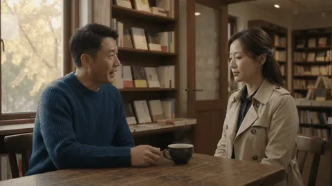

# AI 婚礼微电影

从创意、角色和场景设计，到有声分场试拍、逐镜补拍及剪辑交付的实验项目。以虚构故事和可公开演示的素材验证镜头连续性、人物表演和对白。

## 看样例

[咖啡馆三个机位](examples/cafe/README.md)展示角色四视图、独立空场、导演机位图、同框和两张过肩参考。下方动图节选自换机位试拍，展示切镜效果。

## 制作方法

1. 编剧完成故事、分场和动作对白。
2. 导演定场次目标、演员走位、视线与镜头入出点。
3. 建立人物、妆造、声音、空场和道具参考，每个镜头注明素材职责。
4. 先生成有声同框，检查双方轮流说话和听话，再使用同场素材补正反打。
5. 保留原声与镜头版本，按场审片。关键表演缺失时补拍，图片仅用于有叙事作用的短插入。
6. 全片剪辑、混音之后，做完整解码和现场播放验证。

素材与导演方法参考 Seedance 2.5 官方指南；项目试拍实际使用 Flow、Grok、ImageGen 和 MiniMax，后期使用 FFmpeg 或 Remotion。

## 历史记录

| 阶段 | 内容 |
|---|---|
| [工具验证](docs/history/00-tool-test/) | 34 秒样片和已有工具的验证边界 |
| [故事预演](docs/history/01-v1/) | 独立背景、角色换装与 46 秒故事预演 |
| [海边追信](docs/history/02-v2/) | 15 秒连续动作与最初的三分钟分镜 |
| [三分钟版及复盘](docs/history/03-v3/) | 记录未通过审片的原因、开源流程和新编剧导演稿《再等一班》 |
| [双人对白](docs/history/04-v4/) | 两路有声比较、人物及场景规范、Seedance 方法映射 |
| [三机位](docs/history/05-v5/) | 同框到正反打的资产设计、实际编辑和补剪 |

历史记录保留当时的实验结论。当前被认可的是海边连续动作与咖啡馆三机位短样，三分钟审片版仍未过关。公开包包含经过筛选的虚构人物图和画面节选。完整工作原片、帐号内链接和客户素材留在本地。
